<picture>
  <source media="(prefers-color-scheme: dark)" srcset="assets/banner-dark.svg">
  
</picture>

<p align="center">
  <a href="https://christian070707.github.io/"></a>
  <a href="https://www.linkedin.com/in/christian2007/"></a>
  <a href="mailto:christian.abdalla.07@gmail.com"></a>
</p>

I study Technical Computer Science at the University of Twente and I'm working toward a career as a **quantitative developer**, where low-latency systems engineering meets financial models. At the moment I'm building C++ trading infrastructure for a cryptocurrency market-making system: real-time order book processing, a PostgreSQL/TimescaleDB time-series database, and benchmarks for critical-path latency and throughput.

Alongside my studies I'm an Investment Analyst and Quant Finance Committee member at investment society **SBV Duitenberg**, and a member of **Rabobank's Members' Council**.

```cpp
struct Christian {
    std::string_view based_in = "Enschede, the Netherlands";
    std::string_view study    = "BSc Technical Computer Science @ University of Twente (2025 - 2028)";
    std::string_view goal     = "Quantitative Developer";
    std::array<std::string_view, 3> focus{"low latency", "market microstructure", "systems"};
    std::string_view open_to  = "internships, student jobs, conversations about quant dev";
};
```

<p align="center">
  
  
  
  
  <br>
  
  
  
  
  
  
  
</p>

## Building

### ▸ Hyperliquid: C++ market-making infrastructure &nbsp;

Latency-sensitive C++ trading infrastructure for a crypto market-making system. Order book management, market data handling, and quoting/execution logic driven by real-time websocket data. Includes benchmarks for critical-path latency and a PostgreSQL/TimescaleDB time-series database (with separate production and test environments) hosted on a Debian server.

```text
  Hyperliquid WS ──▶  parser  ──▶  order book  ──▶  quoting  ──▶  execution
   (L2 + trades)     simdjson      L2 · C++         strategy        orders
                                       │
                                       │  ticks, fills, snapshots
                                       ▼
                         PostgreSQL / TimescaleDB
                          prod · test  (Debian)

  └──────────────── benchmarked critical path: latency · throughput ───────────────┘
```

<sub>`C++` · `Market making` · `WebSockets` · `TimescaleDB` · `PostgreSQL` · `simdjson` · `Python`</sub>

### ▸ [C++ limit order book & simulator](https://github.com/Christian070707/Limit-Order-Book) &nbsp;

A limit order book implementing order matching, bid/ask management and trade execution to model market microstructure. Matching runs on price-time priority.

<sub>`C++` · `Order matching` · `Data structures`</sub>

## Selected projects

| Project | What | Stack |
|---|---|---|
| **Quarto: TCP game server** | Full networking stack for the board game Quarto: custom protocol, per-session state machine, thread-safe matchmaking, server-side move validation | Java · TCP · Concurrency |
| **[RISE 5](https://rise5.paas.hosted-by-previder.com/rise/)** | Fullstack web app for an external stakeholder in a five-person Scrum team; I designed the PostgreSQL schema (15+ tables, role-based access) | Java · Vue.js · PostgreSQL |
| **Scuba Chat** | Server-less multi-hop chat network over an emulated underwater acoustic layer; I designed the bit-packed packet header | Java · Distributed systems |
| **[AssetAnalyzer](https://github.com/Christian070707/AssetAnalyzer)** | Stock dashboard computing CAGR, Sharpe ratio, max drawdown and volatility with interactive charts | Python · Streamlit · Plotly |
| **[Financial newsletter bot](https://github.com/Christian070707/FinancialEmailSum)** | Summarizes financial newsletters with an LLM, tags sentiment and delivers them to Telegram every hour | Python · LLM · Telegram API |

## Experience

| | Role | |
|---|---|---|
| **SBV Duitenberg** | Investment Analyst, Quant Finance Committee & External Affairs board member. Equity research, plus trading and coding challenges such as IMC Prosperity | Nov 2025 – now |
| **Rabobank** | Member of the Members' Council and the Youth Forum | Nov 2024 – now |
| **Yara Food B.V.** | Data Intern: sales and procurement analysis in Python and Power BI | Jun – Sep 2025 |

🏆 **2nd place (team)** at the Twente Algorithmic Programming Contest, 2025

---

<p align="center"><sub><code>while (market.open()) { book.update(); quote(); }</code></sub></p>
